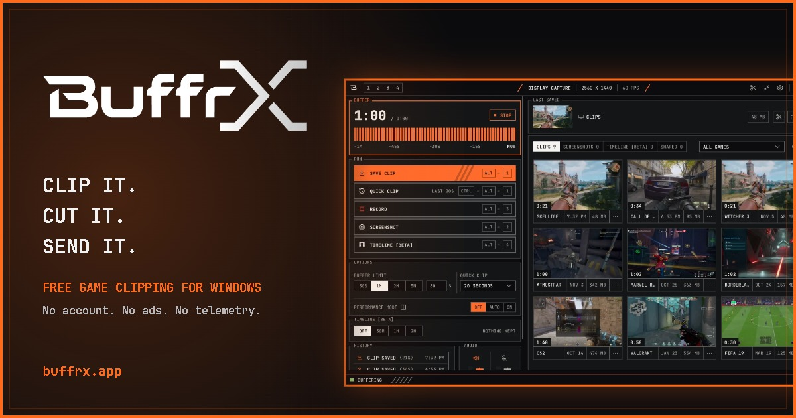
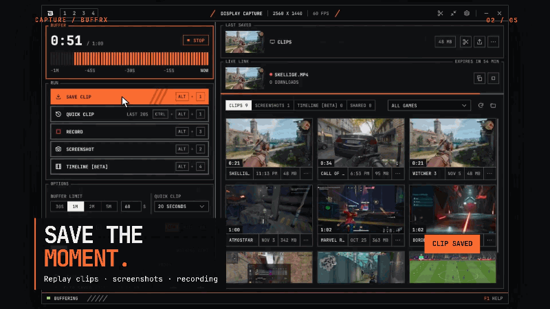

<div align="center">

# BuffrX



&nbsp;

**A free Windows app that clips, edits, rewinds and shares your gameplay, all in one place.**<br>
No account. No ads. No watermark. No telemetry.

&nbsp;

[**Download for Windows**](https://github.com/bulhaa1/BuffrX/releases/latest)
&nbsp;&nbsp;|&nbsp;&nbsp;
[Try the demo](https://bulhaa1.github.io/BuffrX/)
&nbsp;&nbsp;|&nbsp;&nbsp;
[Website](https://buffrx.app)
&nbsp;&nbsp;|&nbsp;&nbsp;
[Discord](https://discord.gg/73Js632Ba)


&nbsp;

| Watch the trailer |
| :---: |
| [](https://github.com/bulhaa1/BuffrX/raw/main/assets/trailer.mp4) |
| [Open the full-quality trailer (30 s)](https://github.com/bulhaa1/BuffrX/raw/main/assets/trailer.mp4) |

</div>

&nbsp;

**On this page:**
[What it is](#what-it-is) ·
[Screenshots](#screenshots) ·
[Five pillars](#the-five-pillars) ·
[Hotkeys](#hotkeys) ·
[Features](#features) ·
[Install](#install) ·
[FAQ](#faq) ·
[Roadmap](#roadmap) ·
[Build](#build-from-source)

---

## What it is

BuffrX keeps the last few minutes of your game in memory. Something great happens, you press
**Alt+1**, and that moment is saved. Then trim it, send it to a friend or post it to Discord, without
opening a second app.

It exists because setting up OBS was a chore. This is one small app that just works.

| Easy to start | No bloat | Free, for real |
| :--- | :--- | :--- |
| Install it, then press `Alt+1` mid-match. Nothing to set up first. | One small app. Low RAM and CPU while it buffers. Nothing else to install. | Open source under the GPL. No account, no trial, no paid tier. |

---

## Screenshots

| The panel: save, record, screenshot and your whole library in one window |
| :---: |
|  |

| The editor: trim, split, crop and export without leaving BuffrX |
| :---: |
|  |

| Timeline (beta): a running film of your game. Scrub back, set markers, save a clip |
| :---: |
|  |

| Share: copy a link and the clip goes straight from your PC to your friend's |
| :---: |
|  |

---

## The five pillars

Every change to BuffrX has to pass all five.

| | Pillar | What it means |
| :-: | :--- | :--- |
| **1** | **Lightweight** | Built to cost your game as little as possible while it buffers: one process, your GPU's hardware encoder, no GPU work at all when the buffer is off. No Chromium runs unless the editor is open, and no second copy of FFmpeg is shipped. |
| **2** | **Un-intrusive** | Nothing is drawn while no window is open. No input hook unless hotkeys are running. No listening socket, except the sharing helper while a BuffrX link you made is live. |
| **3** | **Private** | No accounts, no telemetry, no analytics, no crash reporting. BuffrX reaches the internet only when you press Share, and for a daily check for a new version. |
| **4** | **Simple** | One config file, one process, one set of hotkeys. Depth lives behind one disclosure, never in your way. |
| **5** | **Powerful** | The control surface is the encoder's own, not a subset: codec and vendor choice, quality tiers that map to real encoder properties, duration-first bit-rate budgeting, per-track audio, and a watchdog that recovers a stopped buffer without asking you. |

---

## Hotkeys


Every hotkey can be changed in Settings, and each one also works from a controller.

---

## Features

### Capture

- **Clip and record.** Keep the last 30 seconds to 5 minutes (or a number of your own), or record for
  as long as you like, with or without the buffer running.
- **Timeline (beta).** Records your game continuously for up to 2 hours. Scrub back, pick a moment,
  save it.
- **Auto-detects your game.** Start a fullscreen game and BuffrX switches to it, then back to your
  screen when you quit. Clips are filed per game.
- **Any GPU, any codec.** NVIDIA, AMD or Intel. H.264, HEVC and AV1. No AV1 card? It uses H.264.
- **Keeps up on its own.** If your GPU cannot encode every frame, BuffrX adjusts so no frames are lost.
- **Your sound, your mix.** Game and microphone each get their own track, volume and mute.

### Edit and share

- **Editor built in.** Trim, split, crop, stitch and export. Screenshots get a pen, arrows, text, crop
  and a blur for names.
- **Built-in preview.** Open a clip or screenshot right in the panel. Play and scrub videos, zoom into
  pictures.
- **Share with a link.** Full quality, up to 2 GB, straight from your PC to your friend's with
  nothing uploaded first.
- **Post to Discord.** BuffrX shrinks the clip to fit your upload limit, so no Nitro is needed.

### Make it yours

- **Performance mode.** Slightly lighter settings for competitive games. It can switch on for just
  the games you pick.
- **Profiles.** One for ranked, one for chill. Switch in a click.
- **Controller support.** Clip, screenshot and record from your pad. It also moves around the app.
- **Fourteen themes**, dark and light.

---

## Private by design

| No account | No telemetry | Your clips stay yours | Works offline | No server of ours |
| :--- | :--- | :--- | :--- | :--- |
| Nothing to sign up for. | No analytics code at all. | Stored on your disk, filed by game. | Recording and editing never need the internet. | Sharing goes from your PC to theirs, encrypted. |

The daily update check can download the installer from this repository's own release. Nothing listens
for connections except the sharing helper, and only while a BuffrX link you made is live.

---

## Linux (AppImage)

This branch carries the native Linux port, currently an open PR rather than part of main. It builds
the same engine (libobs 30, X11 capture, VAAPI/x264, PulseAudio, the replay ring and the library), the
Dear ImGui panel drawn with OpenGL, and the Tauri editor running in WebKitGTK, and packages them as a
single AppImage. The port is reported working on Ubuntu 24.04 with an X11 session; other distributions,
drivers and desktops still need testing.

Build it on Ubuntu 24.04 (or a current Debian/Mint):

```bash
sudo apt install build-essential cmake pkg-config libgtk-3-dev libx11-dev libxrandr-dev \
  libavformat-dev libavcodec-dev libavutil-dev libswscale-dev libswresample-dev libavfilter-dev \
  libcurl4-openssl-dev libssl-dev libwebkit2gtk-4.1-0
bash tools/bootstrap-linux.sh   # OBS packages, ImGui/GLFW/stb, fonts, Rust, Node, WebKit .pc files
export RUSTUP_HOME="$PWD/work/rustup" CARGO_HOME="$PWD/work/cargo"
export PATH="$PWD/work/cargo/bin:$PWD/work/toolchain-linux/node-v22.14.0-linux-x64/bin:$PATH"
cmake -S linux -B build-linux && cmake --build build-linux -j8
(cd ui && npm_config_script_shell=/bin/bash npm install --package-lock=false && npm run build)
(cd src-tauri && PKG_CONFIG_PATH="$PWD/../work/linux-ui/pkgconfig" \
  LIBRARY_PATH="$PWD/../work/linux-ui/lib" cargo build --release)
bash tools/package-linux.sh     # -> dist/BuffrX-<version>-x86_64.AppImage
```

Run it with `./dist/BuffrX-0.5.0-x86_64.AppImage`, or pass `--show`. The panel, global hotkeys
(Alt+1 save, Alt+2 screenshot, Alt+3 record, Alt+X toggle, Alt+4 Timeline), recording, screenshots,
the library and the editor with video preview are the working core. The tray icon uses the GTK status
icon and some desktops do not show it; the toggle hotkey and the launcher always open the panel. The
AppImage needs the system's GTK 3 and WebKitGTK 4.1 for the editor, and a H.264-capable GStreamer for
its `<video>` player (both are present on a normal Ubuntu/Mint desktop).

Capture is X11 only. On a Wayland session the app starts through XWayland, which captures XWayland
windows but no native Wayland client. Not yet ported: the share sheet's fit/upload jobs, BuffrX
app-to-app links and Discord posting answer that they are unavailable; controller hotkeys need
XInput and are inactive; game capture uses XComposite window capture (there is no game-hook injection
on Linux), and automatic fullscreen-game detection is off by default.

---

## Install

1. Open the [latest release](https://github.com/bulhaa1/BuffrX/releases/latest) and download
   **`BuffrX-Setup.exe`**. A portable `BuffrX-0.5.0.zip` is there too.
2. Run it.
3. Press `Alt+1` in a game.

Want a look first? [Try the demo in your browser](https://bulhaa1.github.io/BuffrX/). No install.

> **"Windows protected your PC"?** Early releases may not be code-signed yet, so SmartScreen can show
> that notice for any new app. Choose **More info**, then **Run anyway**. The source is public, so you
> can read exactly what it does.

| Requirement | |
| :--- | :--- |
| **OS** | Windows 10 or later, 64-bit |
| **Processor** | Any 64-bit x86 processor |
| **Memory** | 512 MB RAM |
| **Graphics** | Any GPU |
| **Storage** | About 76 MB, plus your clips |

---

## FAQ

<details>
<summary><b>Is it really free? What is the catch?</b></summary>

&nbsp;

There is none. It is open source (GPL), with no account, no trial and no paid tier. The "Premium" on
the website is a joke.
</details>

<details>
<summary><b>Will it cost me frames in my game?</b></summary>

&nbsp;

It is built to stay out of the way: one process, your GPU's hardware encoder, and a buffer that does
no GPU work when it is off. For an even smaller impact turn on Performance mode. No frame-rate number
is published until it has been measured properly on real hardware.
</details>

<details>
<summary><b>Does my friend need BuffrX to get a shared clip?</b></summary>

&nbsp;

Yes (it is free). The clip goes straight from your PC to theirs, so your friend can see your IP: share
links only with people you trust. A link lasts 1 to 24 hours, and **Stop** ends it at once.
</details>

<details>
<summary><b>Does it collect my data?</b></summary>

&nbsp;

No. No accounts, no telemetry, no analytics, no crash reporting.
</details>

---

## Roadmap

| Now (0.5) | Next | Later (ideas, not promises) |
| :--- | :--- | :--- |
| Save, record and screenshot | Linux | HDR and 10-bit colour |
| Timeline (beta) | Shorter share links | Watch a share link in a browser |
| Editor built in | Favourites | More audio sources |
| Quick Share and Discord | Sorting and filters | Captions in the editor |
| Controller support | Hold for 2x in previews | Your own sounds |
| Fourteen themes | | |

---

## Build from source

<details>
<summary>BuffrX links libobs directly into a native engine. No Electron, no Node, no second FFmpeg.</summary>

&nbsp;

One process: `BuffrX.exe` starts `buffrx-engine.exe`, which is the whole app. It runs libobs 33.0.1
in-process (capture, audio, encoders, the replay ring, recording, the Timeline), the tray, the hotkeys,
sharing and the panel, drawn with Dear ImGui. The editor, clip preview and Timeline preview run in a
separate WebView2 process that exists only while one is open.

The toolchain is downloaded, not installed: pinned, SHA-256 verified, staged into `work/`. No Visual
Studio, no system Rust, no system CMake. Run in order:

```powershell
powershell -File tools/bootstrap-toolchain.ps1   # LLVM-MinGW, CMake, Ninja, Windows SDK, WebView2, Dear ImGui, fonts
powershell -File tools/prepare-runtime.ps1       # pinned OBS release -> runtime/
powershell -File tools/prepare-headers.ps1       # libobs public headers
powershell -File tools/build.ps1                 # configure, build, stage into runtime/bin/64bit
```

The editor's page, then a portable package:

```powershell
cd ui; npm install; npm run build; cd ..
powershell -File tools/package.ps1
```

Run and check it:

```powershell
$env:BUFFRX_DATA_ROOT = "$env:TEMP\buffrx-test"                      # keep test state out of your profile
runtime\bin\64bit\buffrx-engine.exe --package-smoke-test            # libobs starts, modules load, clean exit
runtime\bin\64bit\buffrx-engine.exe --capture-smoke-test            # capture ~6 s, save a clip, verify it
runtime\bin\64bit\buffrx-engine.exe --show                          # run for real with the panel open
build\buffrx-tests.exe                                              # unit checks
```

```
src/engine/       libobs host: config, capture, encoders, replay, Timeline, library, protocol, tray
src/engine/ui/    the panel, Settings, quick panel and tray menu (Dear ImGui)
src/launcher/     BuffrX.exe: checks the package, starts the engine
src-share/        buffrx-share.exe (Rust, iroh): the BuffrX link, alive only while one is
src-tauri/, ui/   the editor, clip preview and Timeline preview (Tauri + React)
tools/            bootstrap, build, packaging and probe scripts
```

</details>

---

## License

BuffrX is free software under the **GNU General Public License, version 2 or later**. See
[LICENSE](LICENSE). It links libobs from [OBS Studio 33.0.1](https://github.com/obsproject/obs-studio/tree/33.0.1),
also GPL-2.0-or-later. Third-party notices ship in `licenses/` with every release.

<div align="center">

<sub>If BuffrX saved you a clip, a star on GitHub is plenty. &nbsp;|&nbsp; <a href="https://buffrx.app">buffrx.app</a></sub>

</div>
