<div align="center">


&nbsp;

### A free, open-source game clipping app for Windows 10 and 11.

Save the last minute of your game on one hotkey, then rewind, edit and share it.<br>
No account. No ads. No watermark. No telemetry.

&nbsp;

[](https://github.com/bulhaa1/BuffrX/releases/latest)
[](https://bulhaa1.github.io/BuffrX/)
[](https://buffrx.app)
[](https://discord.gg/73Js632Ba)


<a href="https://alternativeto.net/software/buffrx/about/?utm_source=badge&utm_medium=referral" target="_blank">
  
</a>

&nbsp;

 **Status:** in active development. Windows 10 and 11 today. The Timeline is in beta, and Linux is planned.

</div>

BuffrX is a free alternative to NVIDIA ShadowPlay, AMD ReLive, Xbox Game Bar, Steam Game Recording and the OBS replay buffer that works
on NVIDIA, AMD and Intel graphics. [What is BuffrX?](https://buffrx.app/about/) ·
[Compare the apps](https://buffrx.app/alternatives/) · [How-to guides](https://buffrx.app/how-to/)

<sub>**On this page:** [Quick start](#quick-start) · [See it](#see-it) · [How it works](#how-it-works) · [Features](#features) · [Hotkeys](#hotkeys) · [Pillars](#the-five-pillars) · [Install](#install) · [FAQ](#faq) · [Roadmap](#roadmap) · [Contribute](#contributing)</sub>

<a id="quick-start"></a>
<h2>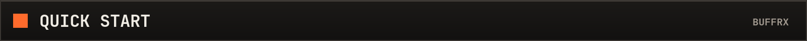</h2>

<div align="center">

| 1. Download | 2. Run it | 3. Press `Alt+1` |
| :---: | :---: | :---: |
| **[BuffrX-Setup.exe](https://github.com/bulhaa1/BuffrX/releases/latest)**<br><sub>from the latest release</sub> | **Install and start**<br><sub>no account, nothing to set up</sub> | **In any game**<br><sub>your last minute is saved</sub> |

</div>

Want a look first? [Try the demo in your browser](https://bulhaa1.github.io/BuffrX/). No install.

<a id="what-it-is"></a>
<h2>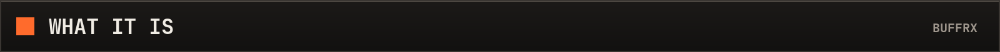</h2>

BuffrX keeps the last few minutes of your game in memory. Something great happens, you press
**Alt+1**, and that moment is saved. Then trim it, send it to a friend or post it to Discord, without
opening a second app.

It exists because setting up OBS was a chore. This is one small app that just works.

| Easy to start | No bloat | Free, for real |
| :--- | :--- | :--- |
| Install it, then press `Alt+1` mid-match. Nothing to set up first. | One small app. Low RAM and CPU while it buffers. Nothing else to install. | Open source under the GPL. No account, no trial, no paid tier. |

**What sets BuffrX apart**

| Rewind, not just replay | Send it PC to PC | Sound per app | Your pad runs it all |
| :--- | :--- | :--- | :--- |
| The **Timeline** (`Alt+4`) keeps up to 2 hours of your session. Scrub back, see a loudness profile, set markers and clip from anywhere. | A **BuffrX link** is encrypted and expires. The clip goes straight to your friend, up to 2 GB, with nothing uploaded. | Switch on per-app capture and the game, chat and music land on **separate tracks**. | **Every action** has a controller chord, and the whole app moves with a pad. |

<a id="see-it"></a>
<h2>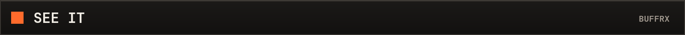</h2>

<div align="center">

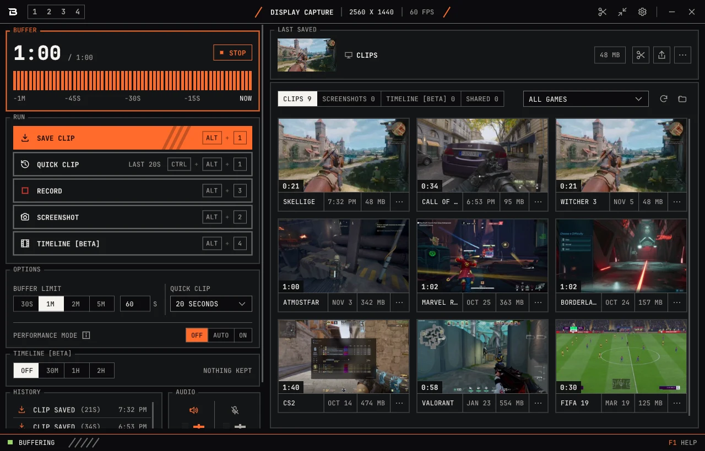

<sub>The panel: save, record, screenshot and your whole library in one window.</sub>

&nbsp;

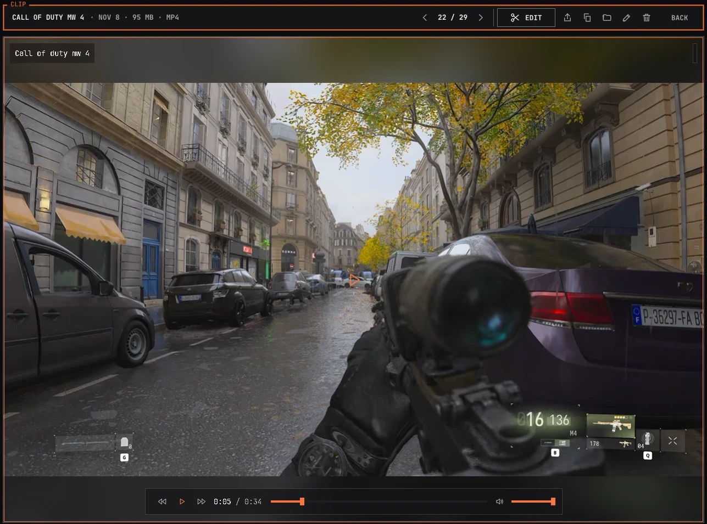

<sub><b>Built-in previewer.</b> Clips and screenshots open right inside BuffrX. Play, scrub and step through a clip, then edit, share, copy, rename or delete it from the same bar. No second app.</sub>

&nbsp;

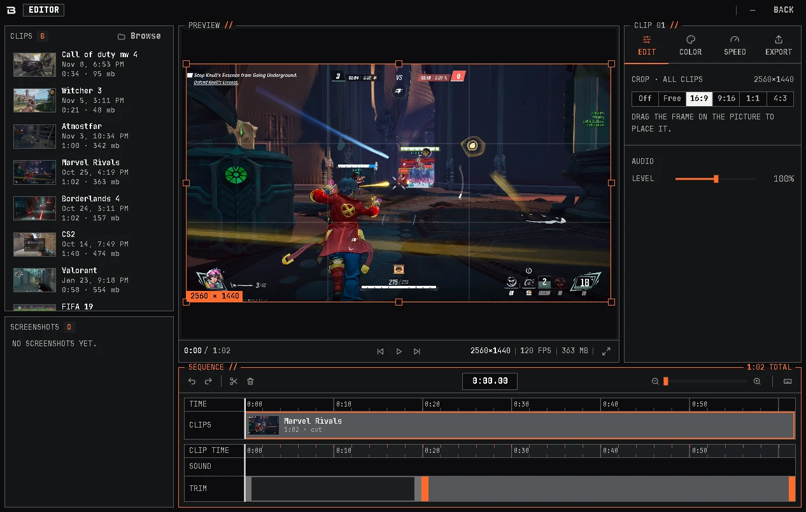

<sub>The editor: trim, split, crop and export without leaving BuffrX.</sub>

&nbsp;

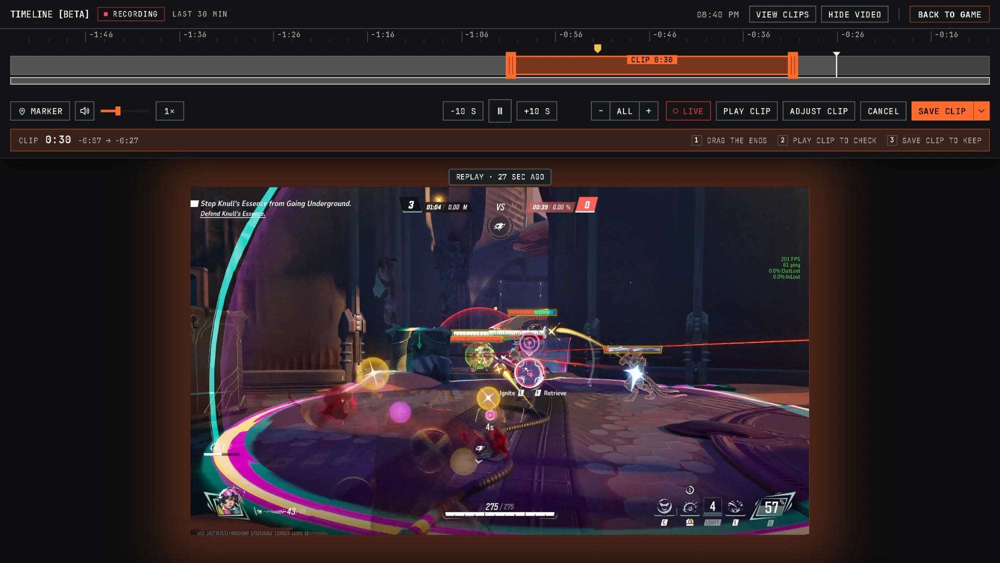

<sub>Timeline (beta): a running film of your game. Scrub back, set markers, save a clip.</sub>

&nbsp;

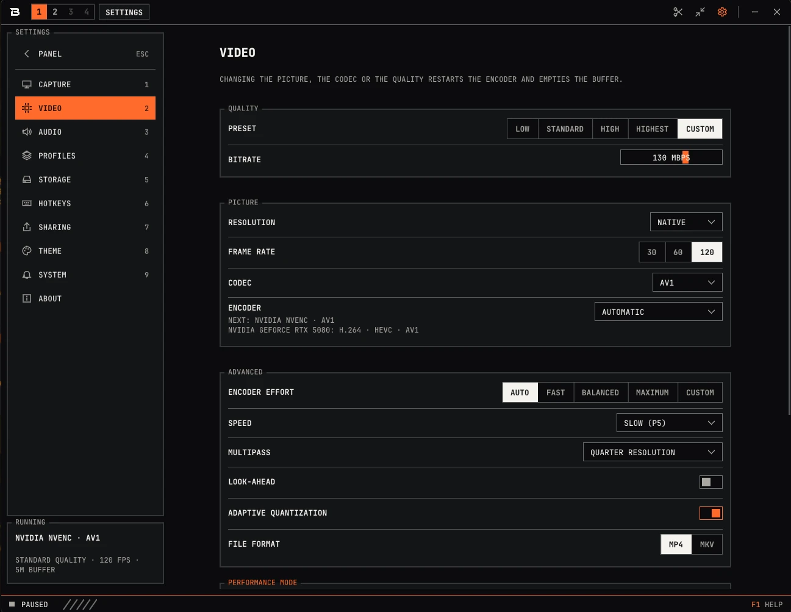

<sub><b>Quality your way.</b> Pick anything from Low to Highest, or type your own bitrate. Choose the codec, encoder and frame rate too. Changing them restarts the encoder and empties the buffer.</sub>

&nbsp;

<table>
<tr>
<td align="center">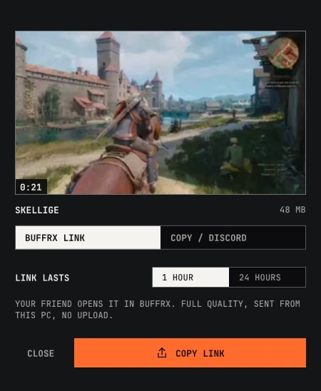</td>
<td align="center">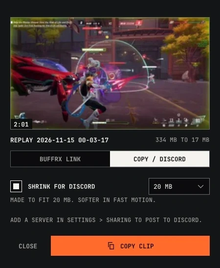</td>
</tr>
<tr>
<td align="center"><sub><b>BuffrX link.</b> Copy a link and the clip goes straight from your PC to your friend's.</sub></td>
<td align="center"><sub><b>Copy or post to Discord.</b> Shrink the clip to fit your upload limit. No Nitro needed.</sub></td>
</tr>
</table>

</div>

<details>
<summary><b>Watch the trailer (30 s)</b></summary>

&nbsp;

<div align="center">

[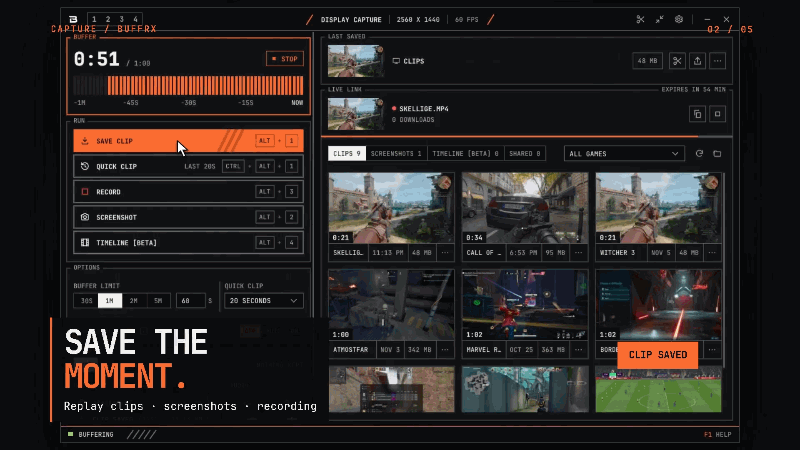](https://github.com/bulhaa1/BuffrX/raw/main/assets/trailer.mp4)

[Open the full-quality trailer](https://github.com/bulhaa1/BuffrX/raw/main/assets/trailer.mp4)

</div>
</details>

<a id="how-it-works"></a>
<h2>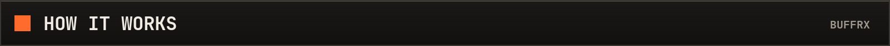</h2>

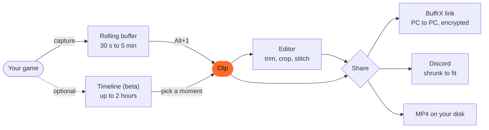

Everything stays on your PC until you press **Share**. There is no BuffrX server in the path.

<a id="features"></a>
<h2>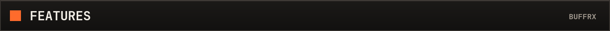</h2>

### Capture

- **Clip and record.** Keep the last 30 seconds to 5 minutes (or a number of your own), or record for
  as long as you like, with or without the buffer running.
- **Timeline (beta).** Records your game continuously for up to 2 hours. Scrub back, pick a moment,
  save it.
- **Auto-detects your game.** Start a fullscreen game and BuffrX switches to it, then back to your
  screen when you quit. Clips are filed per game.
- **Any GPU, any codec.** NVIDIA, AMD or Intel. H.264, HEVC and AV1. No AV1 card? It uses H.264.
- **Keeps up on its own.** If your GPU cannot encode every frame, BuffrX adjusts so no frames are lost.
- **Your sound, your mix.** Desktop and microphone each get their own track, volume and mute. Turn on per-app capture and individual apps (the game, chat, music) land on separate tracks.

### Edit and share

- **Editor built in.** Trim, split, crop, stitch and export. Screenshots get a pen, arrows, text, crop
  and a blur for names.
- **Built-in preview.** Open a clip or screenshot right in the panel. Play and scrub videos, zoom into
  pictures.
- **Share with a link.** Full quality, up to 2 GB, straight from your PC to your friend's with
  nothing uploaded first.
- **Post to Discord.** BuffrX shrinks the clip to fit your upload limit, so no Nitro is needed.

### Make it yours

- **Performance mode.** Slightly lighter settings for competitive games. It can switch on for just
  the games you pick.
- **Profiles.** One for ranked, one for chill. Switch in a click.
- **Controller support.** Clip, screenshot and record from your pad. It also moves around the app.
- **Fourteen themes**, dark and light.

<a id="hotkeys"></a>
<h2>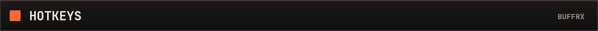</h2>

| Action | Keyboard | Controller |
| :--- | :---: | :---: |
| Save clip (the buffer's last stretch) | `Alt+1` | `LB+RB` |
| Quick clip (the last 20 seconds, or your own length) | `Ctrl+Alt+1` | *yours to bind* |
| Screenshot | `Alt+2` | `LS+RS` |
| Start or stop recording | `Alt+3` | `View+Menu` |
| Open the Timeline | `Alt+4` | *yours to bind* |
| Add a marker | `Alt+5` | *yours to bind* |
| Show or hide the panel | `Alt+X` | `Y+View` |

Every hotkey can be changed in Settings, and every action can be bound to a controller chord. The ones marked *yours to bind* are free for you to set.

<a id="the-five-pillars"></a>
<h2>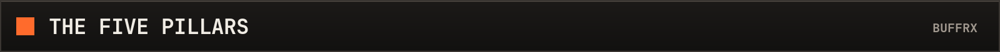</h2>

Every change to BuffrX has to pass all five.

| | Pillar | What it means |
| :-: | :--- | :--- |
| **1** | **Lightweight** | Built to cost your game as little as possible while it buffers: one process, your GPU's hardware encoder, no GPU work at all when the buffer is off. No Chromium runs unless the editor is open, and no second copy of FFmpeg is shipped. |
| **2** | **Un&#8209;intrusive** | Nothing is drawn while no window is open. No input hook unless hotkeys are running. No listening socket, except the sharing helper while a BuffrX link you made is live. |
| **3** | **Private** | No accounts, no telemetry, no analytics, no crash reporting. BuffrX reaches the internet only when you press Share, and for a daily check for a new version. |
| **4** | **Simple** | One config file, one process, one set of hotkeys. Depth lives behind one disclosure, never in your way. |
| **5** | **Powerful** | The control surface is the encoder's own, not a subset: codec and vendor choice, quality tiers that map to real encoder properties, duration-first bit-rate budgeting, per-track audio, and a watchdog that recovers a stopped buffer without asking you. |

<a id="private-by-design"></a>
<h2>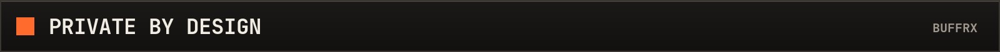</h2>

| No account | No telemetry | Your clips stay yours | Works offline | No server of ours |
| :--- | :--- | :--- | :--- | :--- |
| Nothing to sign up for. | No analytics code at all. | Stored on your disk, filed by game. | Recording and editing never need the internet. | Sharing goes from your PC to theirs, encrypted. |

The daily update check can download the installer from this repository's own release. Nothing listens
for connections except the sharing helper, and only while a BuffrX link you made is live.

<a id="install"></a>
<h2>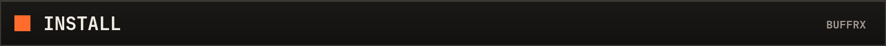</h2>

1. Open the [latest release](https://github.com/bulhaa1/BuffrX/releases/latest) and download
   **`BuffrX-Setup.exe`**. A portable zip is there too.
2. Run it.
3. Press `Alt+1` in a game.

> **"Windows protected your PC"?** Early releases may not be code-signed yet, so SmartScreen can show
> that notice for any new app. Choose **More info**, then **Run anyway**. The source is public, so you
> can read exactly what it does.

| Requirement | |
| :--- | :--- |
| **OS** | Windows 10 or later, 64-bit |
| **Processor** | Any 64-bit x86 processor |
| **Memory** | 512 MB RAM |
| **Graphics** | Any GPU |
| **Storage** | About 80 MB, plus your clips |

<a id="faq"></a>
<h2>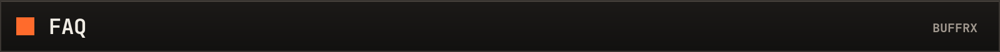</h2>

<details>
<summary><b>Is it really free? What is the catch?</b></summary>
There is none. It is open source (GPL), with no account, no trial and no paid tier. The "Premium" on the website is a joke.
</details>

<details>
<summary><b>Will it cost me frames in my game?</b></summary>
It is built to stay out of the way: one process, your GPU's hardware encoder, and a buffer that does no GPU work when it is off. For an even smaller impact turn on Performance mode. No frame-rate number is published until it has been measured properly on real hardware.
</details>

<details>
<summary><b>Does it work on AMD and Intel graphics?</b></summary>
Yes. BuffrX uses your GPU's own encoder: NVENC on NVIDIA, AMF on AMD and QSV on Intel, with H.264, HEVC and AV1 where the card supports them.
</details>

<details>
<summary><b>Does my friend need BuffrX to get a shared clip?</b></summary>
Yes (it is free). The clip goes straight from your PC to theirs, so your friend can see your IP: share links only with people you trust. A link lasts 1 to 24 hours, and <b>Stop</b> ends it at once.
</details>

<details>
<summary><b>Does it collect my data?</b></summary>
No. No accounts, no telemetry, no analytics, no crash reporting.
</details>

<a id="roadmap"></a>
<h2>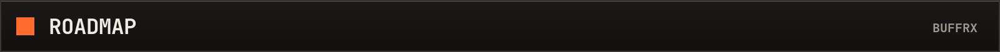</h2>

| Shipped | Next | Later (ideas, not promises) |
| :--- | :--- | :--- |
| Save, record and screenshot | Linux | HDR and 10-bit colour |
| Timeline (beta) | Favourites | Watch a share link in a browser |
| Editor built in | Sorting and filters | More audio sources |
| Quick Share and Discord | Hold for 2x in previews | Captions in the editor |
| Shorter share links | | Your own sounds |
| Controller support | | |
| Fourteen themes | | |

<a id="build-from-source"></a>
<h2>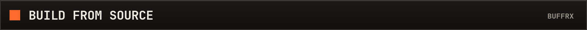</h2>

<details>
<summary>BuffrX links libobs directly into a native engine. No Electron, no Node, no second FFmpeg.</summary>

&nbsp;

One process: `BuffrX.exe` starts `buffrx-engine.exe`, which is the whole app. It runs libobs 33.0.1
in-process (capture, audio, encoders, the replay ring, recording, the Timeline), the tray, the hotkeys,
sharing and the panel, drawn with Dear ImGui. The editor, clip preview and Timeline preview run in a
separate WebView2 process that exists only while one is open.

Follow the [development guide](DEVELOPMENT.md) for setup, checks, and running the app.
Choose documentation, editor, or native logic first; you only need the full Windows
build for changes that exercise the app. The minimal native test setup needs no OBS
download or GPU. Build tools live in `work/`; no Visual Studio is required.

```
src/engine/       libobs host: config, capture, encoders, replay, Timeline, library, protocol, tray
src/engine/ui/    the panel, Settings, quick panel and tray menu (Dear ImGui)
src/launcher/     BuffrX.exe: checks the package, starts the engine
src-share/        buffrx-share.exe (Rust, iroh): the BuffrX link, alive only while one is
src-tauri/, ui/   the editor, clip preview and Timeline preview (Tauri + React)
tools/            bootstrap, build, packaging and probe scripts
```

</details>

<a id="contributing"></a>
<h2>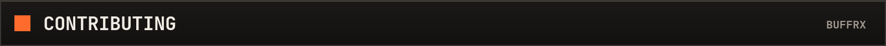</h2>

BuffrX is open source, and I'd love for you to help shape it. Bring your ideas,
fix something that bugs you, or build a feature you'd like to use.

First-time contributors are welcome. Small fixes, docs, testing, and feedback all
help. Feel free to open a draft PR and work things out as you go.

Have an idea that could make BuffrX better? [Share it in Ideas](https://github.com/bulhaa1/BuffrX/discussions/categories/ideas).
I'd love to hear what you'd like to see.

- Read [CONTRIBUTING.md](CONTRIBUTING.md) to get started.
- Ask a question or find an answer in [Q&A](https://github.com/bulhaa1/BuffrX/discussions/categories/q-a).
- Report reproducible bugs in [Issues](https://github.com/bulhaa1/BuffrX/issues).
- Build and check your change with the [development guide](DEVELOPMENT.md).
- Help with the native Linux port using the [Linux guide](DEVELOPMENT_LINUX.md).
- Using an agent? Point it to [CONTRIBUTOR_AGENT.md](CONTRIBUTOR_AGENT.md).

<a id="license"></a>
<h2>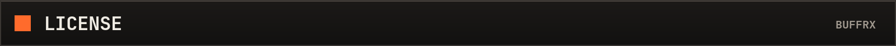</h2>

BuffrX is free software under the **GNU General Public License, version 2 or later**. See
[LICENSE](LICENSE). It links libobs from [OBS Studio 33.0.1](https://github.com/obsproject/obs-studio/tree/33.0.1),
also GPL-2.0-or-later. Third-party notices ship in `licenses/` with every release.

<div align="center">

<sub>If BuffrX saved you a clip, a star on GitHub is plenty. &nbsp;|&nbsp; <a href="https://buffrx.app">buffrx.app</a></sub>

</div>
