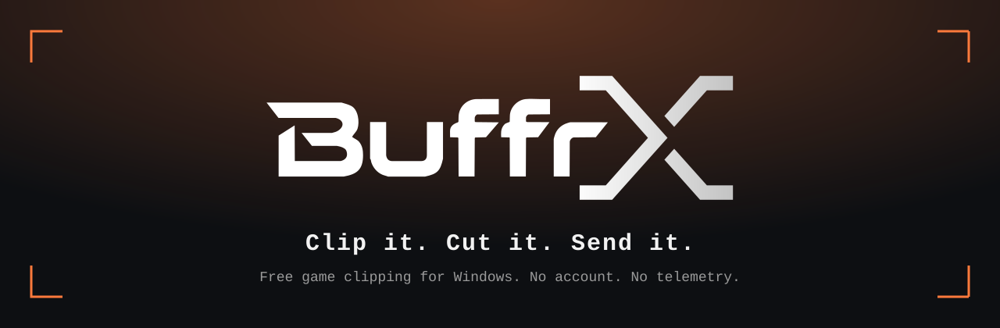

  

  <b>Coming November 2026</b> · Windows 10 and 11 · Any GPU · Free

  <a href="https://bulhaa1.github.io/BuffrX/"><b>Website</b></a> ·
  <a href="https://discord.gg/WekueJhR7"><b>Discord</b></a> ·
  <a href="#whats-coming"><b>Roadmap</b></a>

---

## From Rewind to BuffrX

BuffrX is the next step after my earlier project, [Rewind](https://github.com/bulhaa1/Rewind). It is not an update to it. It is
rebuilt from the ground up, with everything Rewind taught me about what a clipping tool needs, and what gets in the way, built in
from the first line. Same idea, a level up.

BuffrX keeps the last minute of your game, so the moment you almost missed is never lost. Press a key to save it, cut it in the
built-in editor, and send it to a friend. One small app, no account, no telemetry.

## Features

| | |
| :-- | :-- |
| **Record, save, screenshot** | Four hotkeys that work from inside a game. The last minute is always kept for you. |
| **One library for everything** | Recordings, saved moments and screenshots in one place, filed by game. Preview any clip, then trim it in the same window. |
| **Editing built in** | Trim, split and delete parts on a timeline, set each audio track's volume, crop to 9:16 for a vertical clip. Where it can, a cut is copied without loss. |
| **Insta Share** | A link in the Share sheet sends a clip straight to a friend, up to 4 GB, in full quality. No upload first and no server of ours. The link never carries your IP, and Stop ends it at once. |
| **Discord-ready in one tick** | Too big for the chat? BuffrX picks the biggest picture that fits your limit: 20, 50, 100 or 500 MiB. |
| **Auto game capture** | Start a fullscreen game and BuffrX switches to it. Alt-tab to a chat and it keeps the game. |
| **The game comes first** | It never takes the game's focus. Alt+4 shows the clip you just made in a small window over the game. |
| **Two sizes, one app** | The whole panel, or a small quick panel from the tray. Both in fourteen themes. |
| **Keyboard first** | Tab, arrows, Enter, E to edit, S to share. The mouse works too, it is just never required. |

## Private by design

- No accounts, no telemetry, no analytics code.
- BuffrX goes online only when you press a button for it: the update check, Insta Share, or a post to your Discord webhook.
- Nothing listens for a connection, except while an Insta Share link you made is live.

## What's coming

| | | |
| :-- | :-- | :-- |
| **At launch · Nov 2026** | Record, save and screenshot · one library with an editor built in · Insta Share and Discord · fourteen themes | Windows, any GPU, no account |
| **Next** | **Linux** (not at launch) · cleaner mic (noise suppression, gate, compressor) · the game on its own audio track · more audio sources | Planned, no date |
| **Later** | HDR and 10-bit colour · watch an Insta Share link in a browser · full controller support · markers while recording | Ideas, not promises |

## System requirements

| | |
| :-- | :-- |
| OS | Windows 10 or 11, 64-bit |
| Processor | Any 64-bit x86 processor |
| Memory | 512 MB RAM |
| Graphics | Any GPU |
| Storage | About 80 MB for the app, plus room for your clips |
| Notes | WebView2 runtime for the editor. Network only when you press a button. |

## The source

This repository holds the BuffrX website (`site/`). The app's source code is released here under the GPL in **November 2026**,
together with the first download. Watch the repository to see it the day it lands.

## License

GPL-2.0-or-later, see [LICENSE](LICENSE). The fonts under `site/fonts/` keep their own licences (SIL OFL). The game pictures
under `site/games/` are the maker's own captures; see `site/games/SOURCES.md`.
