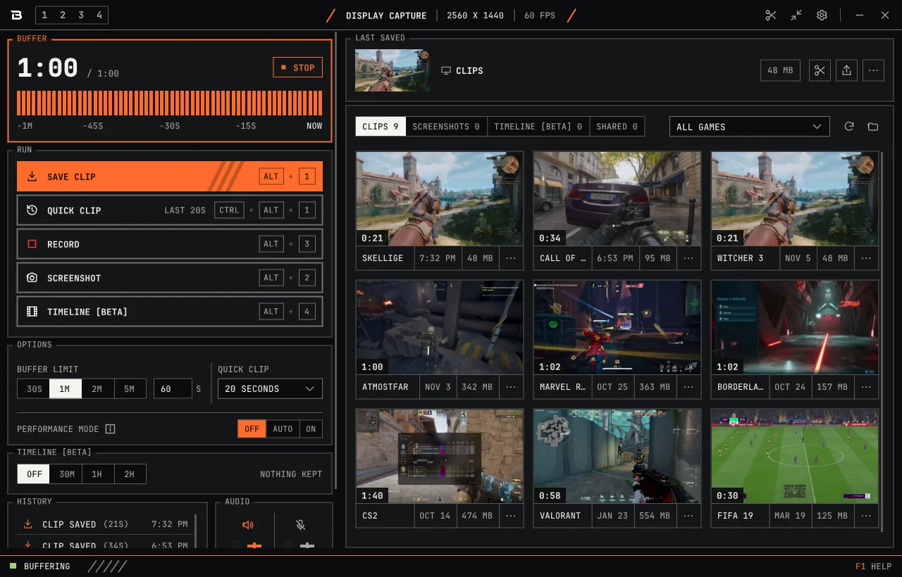
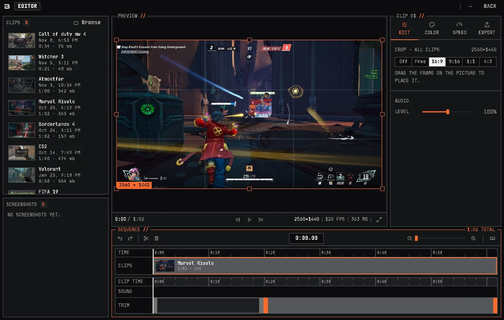
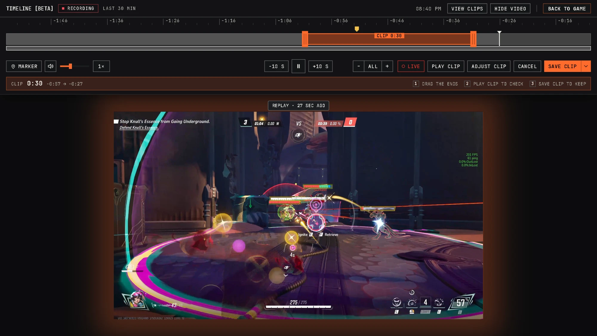
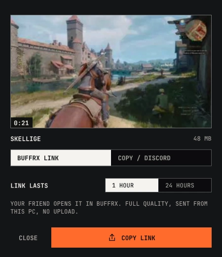

<div align="center">

# BuffrX

### Clip it. Cut it. Send it.

**A free Windows app that clips, edits, rewinds and shares your gameplay, all in one place.**
No account. No ads. No watermark. No telemetry.

[**⬇ Download for Windows**](https://github.com/bulhaa1/BuffrX/releases/latest) &nbsp;·&nbsp; [▶ Try the demo](https://bulhaa1.github.io/BuffrX/) &nbsp;·&nbsp; [Website](https://buffrx.app) &nbsp;·&nbsp; [Discord](https://discord.gg/73Js632Ba) &nbsp;·&nbsp; [Source](#build-from-source)


</div>

&nbsp;

| 🎬 **Watch the trailer** |
| :---: |
| <video src="https://github.com/bulhaa1/BuffrX/raw/main/assets/trailer.mp4" controls muted width="100%"></video> |
| *Video not playing? [Open the trailer](assets/trailer.mp4).* |

&nbsp;

## What it is

BuffrX keeps the last few minutes of your game in memory. Something great happens, you press
**Alt+1**, and that moment is saved. Then trim it, send it to a friend or post it to Discord, without
opening a second app.

It exists because setting up OBS was a chore. This is one small app that just works.

| | |
| --- | --- |
| **🎯 Easy to start** | Install it, then press `Alt+1` mid-match. There is nothing to set up first. |
| **🪶 No bloat** | One small app. Low RAM and CPU while it buffers. Nothing else to install, nothing to sign up for. |
| **🔓 Free, for real** | Open source under the GPL. No account, no trial, no paid tier. |

&nbsp;

## See it

| **The panel**: save, record, screenshot and your whole library in one window |
| :---: |
|  |

| **The editor**: trim, split, crop and export without leaving BuffrX |
| :---: |
|  |

| **Timeline (beta)**: a running film of your game. Scrub back, set markers, save a clip |
| :---: |
|  |

| **Share**: copy a link and the clip goes straight from your PC to your friend's |
| :---: |
|  |

&nbsp;

## Hotkeys

| Key | Does |
| --- | --- |
| `Alt` + `1` | **Save clip**: the whole buffer |
| `Ctrl` + `Alt` + `1` | **Quick clip**: just the last 20 seconds (you choose how long) |
| `Alt` + `2` | **Screenshot** |
| `Alt` + `3` | **Record** on, press again for off |
| `Alt` + `4` | **Timeline** preview |

Every hotkey can be changed in Settings, and all of them also work from a controller.

&nbsp;

## Everything you need

- **Clip and record.** Keep the last 30 seconds to 5 minutes (or a number of your own), or record for as long as you like,
  with or without the buffer running.
- **Timeline (beta).** Records your game continuously for up to 2 hours. Scrub back, pick a moment,
  save it.
- **Editor built in.** Trim, split, crop, stitch and export. Screenshots get a pen, arrows, text, crop
  and a blur for names.
- **Auto-detects your game.** Start a fullscreen game and BuffrX switches to it, then back to your
  screen when you quit. Clips are filed per game.
- **Share.** Send a BuffrX link (full quality, up to 2 GB, straight between PCs with nothing
  uploaded first), or post to Discord. BuffrX shrinks the clip to fit your upload limit, no Nitro needed.
- **Any GPU, any codec.** NVIDIA, AMD or Intel. H.264, HEVC and AV1. No AV1 card? It uses H.264.
- **Keeps up on its own.** If your GPU cannot encode every frame, BuffrX adjusts so no frames are lost.
- **Your sound, your mix.** Game and microphone each get their own track, volume and mute.
- **Performance mode.** Slightly lighter settings for competitive games. It can switch on for just
  the games you pick.
- **Profiles.** One for ranked, one for chill. Switch in a click.
- **Controller support.** Clip, screenshot and record from your pad. It also moves around the app.
- **Fourteen themes**, dark and light.

&nbsp;

## Private by design

| | |
| --- | --- |
| **No account** | Nothing to sign up for. |
| **No telemetry** | No analytics code at all. |
| **Your clips stay yours** | Stored on your disk, filed by game. |
| **Works offline** | Recording and editing never need the internet. |
| **No server of ours** | Sharing goes from your PC to theirs, encrypted. |

BuffrX reaches the internet only when you press Share, and for a daily check for a new version
(which can download the installer from this repo's own release). Nothing listens for connections
except the sharing helper, and only while a BuffrX link you made is live.

&nbsp;

## Install

1. Open the [latest release](https://github.com/bulhaa1/BuffrX/releases/latest) and download
   **`BuffrX-Setup.exe`**. A portable `BuffrX-0.5.0.zip` is there too.
2. Run it. Windows 10 or later, 64-bit, any GPU.
3. Press `Alt+1` in a game.

Want a look first? **[Try the demo in your browser](https://bulhaa1.github.io/BuffrX/)**, no install.

> **"Windows protected your PC"?** Early releases may not be code-signed yet, so SmartScreen can show
> that notice for any new app. Choose **More info**, then **Run anyway**. The source is public, so you
> can read exactly what it does.

**Needs:** Windows 10 or later (64-bit) · any GPU · 512 MB RAM · about 76 MB of disk, plus your clips.

&nbsp;

## FAQ

<details>
<summary><b>Is it really free? What is the catch?</b></summary>

There is none. It is open source (GPL), there is no account, no trial and no paid tier. The
"Premium" on the website is a joke.
</details>

<details>
<summary><b>Will it cost me frames in my game?</b></summary>

It is built to stay out of the way: one process, your GPU's hardware encoder, and a buffer that does
no GPU work when it is off. For an even smaller impact turn on Performance mode. No frame-rate number
is published until it has been measured properly on real hardware.
</details>

<details>
<summary><b>Does my friend need BuffrX to get a shared clip?</b></summary>

Yes (it is free). The clip goes straight from your PC to theirs, so your friend can see your IP: share
links only with people you trust. A link lasts 1 to 24 hours and **Stop** ends it at once.
</details>

<details>
<summary><b>Does it collect my data?</b></summary>

No. No accounts, no telemetry, no analytics, no crash reporting.
</details>

&nbsp;

## Where it's going

**Now (0.5):** save, record and screenshot · Timeline (beta) · editor · Quick Share and Discord ·
controller support · fourteen themes.

**Next:** Linux · shorter share links · favourites · sorting and filters · hold for 2× in previews.

**Later (ideas, not promises):** HDR and 10-bit · watch a share link in a browser · more audio
sources · captions in the editor · your own sounds.

&nbsp;

## Build from source

<details>
<summary>BuffrX links libobs directly into a native engine. No Electron, no Node, no second FFmpeg.</summary>

&nbsp;

One process: `BuffrX.exe` starts `buffrx-engine.exe`, which is the whole app. It runs libobs 33.0.1
in-process (capture, audio, encoders, the replay ring, recording, the Timeline), the tray, the hotkeys,
sharing and the panel, drawn with Dear ImGui. The editor, clip preview and Timeline preview run in a
separate WebView2 process that exists only while one is open.

The toolchain is downloaded, not installed: pinned, SHA-256 verified, staged into `work/`. No Visual
Studio, no system Rust, no system CMake. Run in order:

```powershell
powershell -File tools/bootstrap-toolchain.ps1   # LLVM-MinGW, CMake, Ninja, Windows SDK, WebView2, Dear ImGui, fonts
powershell -File tools/prepare-runtime.ps1       # pinned OBS release -> runtime/
powershell -File tools/prepare-headers.ps1       # libobs public headers
powershell -File tools/build.ps1                 # configure, build, stage into runtime/bin/64bit
```

The editor's page, then a portable package:

```powershell
cd ui; npm install; npm run build; cd ..
powershell -File tools/package.ps1
```

Run and check it:

```powershell
$env:BUFFRX_DATA_ROOT = "$env:TEMP\buffrx-test"                      # keep test state out of your profile
runtime\bin\64bit\buffrx-engine.exe --package-smoke-test            # libobs starts, modules load, clean exit
runtime\bin\64bit\buffrx-engine.exe --capture-smoke-test            # capture ~6 s, save a clip, verify it
runtime\bin\64bit\buffrx-engine.exe --show                          # run for real with the panel open
build\buffrx-tests.exe                                              # unit checks
```

```
src/engine/       libobs host: config, capture, encoders, replay, Timeline, library, protocol, tray
src/engine/ui/    the panel, Settings, quick panel and tray menu (Dear ImGui)
src/launcher/     BuffrX.exe: checks the package, starts the engine
src-share/        buffrx-share.exe (Rust, iroh): the BuffrX link, alive only while one is
src-tauri/, ui/   the editor, clip preview and Timeline preview (Tauri + React)
tools/            bootstrap, build, packaging and probe scripts
```

</details>

&nbsp;

## License

BuffrX is free software under the **GNU General Public License, version 2 or later**. See
[LICENSE](LICENSE). It links libobs from [OBS Studio 33.0.1](https://github.com/obsproject/obs-studio/tree/33.0.1),
also GPL-2.0-or-later. Third-party notices ship in `licenses/` with every release.

<div align="center">

**If BuffrX saved you a clip, a ⭐ on GitHub is plenty.**

[buffrx.app](https://buffrx.app)

</div>
